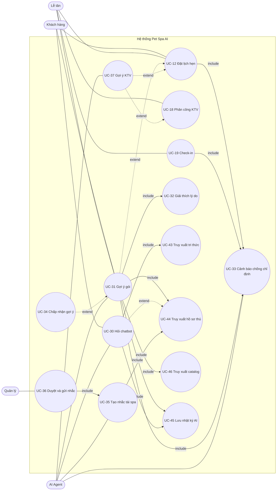

# 04. Use case

Quy ước (Chương 3): tên dạng **Động từ + Danh từ**; actor đặt ngoài khung hệ thống; `<<include>>` = bước luôn chạy; `<<extend>>` = bước tùy chọn có điều kiện. Pha 3 và Pha 4 không có trong danh sách.

Quy tắc vẽ AI (theo ghi chú `05_TheoNguoiDung`): AI Agent **không** đứng riêng. Mọi use case AI gắn vào một use case của người qua include/extend, và include các use case "truy xuất dữ liệu" (hồ sơ thú, catalog, tri thức, nhật ký). Chỉ AI Agent liên kết với use case truy xuất; người không liên kết trực tiếp.

## 4.1 Danh sách use case Pha 1

| UC | Tên use case | Actor chính | SPA | Loại | Quan hệ |
|----|--------------|-------------|-----|------|---------|
| UC-01 | Quản lý hồ sơ spa | Quản lý | 01 | BB | — |
| UC-02 | Đăng nhập / đăng xuất | Tất cả người | 02 | BB | Được `<<include>>` bởi mọi use case cần đăng nhập |
| UC-03 | Đăng ký tài khoản khách | Khách | 02, 07 | BB | `<<extend>>` UC-02 |
| UC-04 | Quản lý tài khoản nhân viên | Quản lý | 02, 13 | BB | — |
| UC-05 | Cập nhật tài khoản cá nhân | Tất cả người | 03 | NC | — |
| UC-06 | Quản lý danh mục dịch vụ | Quản lý | 04 | BB | — |
| UC-07 | Quản lý gói combo | Quản lý | 05 | BB | `<<include>>` UC-06 (gói gồm dịch vụ) |
| UC-08 | Quản lý bảng giá theo size | Quản lý | 06 | BB | — |
| UC-09 | Xem danh mục, gói và giá | Khách, Lễ tân, KTV | 04–06 | BB | — |
| UC-10 | Quản lý hồ sơ khách | Lễ tân, Quản lý | 07 | BB | — |
| UC-11 | Quản lý hồ sơ thú | Khách, Lễ tân, KTV | 08 | BB | Chứa tiêm phòng, thẻ sức khỏe. Dữ liệu đầu vào của AI |
| UC-12 | Đặt lịch hẹn | Khách, Lễ tân | 09, 16 | BB | `<<include>>` UC-41 Kiểm tra trùng lịch và công suất; `<<include>>` UC-42 Tính giá theo size; `<<include>>` UC-33 Cảnh báo chống chỉ định; `<<extend>>` UC-31 Gợi ý gói; `<<extend>>` UC-37 Gợi ý kỹ thuật viên |
| UC-13 | Sửa / hủy lịch hẹn | Khách, Lễ tân, Quản lý | 09 | BB | `<<include>>` UC-41; UC-33 chạy lại nếu đổi dịch vụ |
| UC-14 | Duyệt / từ chối lịch hẹn | Lễ tân, Quản lý | 10 | BB | `<<extend>>` UC-12 (lịch `pending`) |
| UC-15 | Xem lịch và tra cứu lịch hẹn | Lễ tân, KTV, Quản lý | 09, 11 | BB | — |
| UC-16 | Xem chi tiết lịch hẹn | KTV, Lễ tân, Quản lý | 12 | BB | `<<include>>` UC-33 (hiện huy hiệu an toàn) |
| UC-17 | Quản lý nhân sự và giờ làm | Quản lý, KTV | 13 | BB | `<<extend>>` UC-04 |
| UC-18 | Phân công kỹ thuật viên | Quản lý, Lễ tân | 14 | BB | `<<extend>>` UC-37 Gợi ý kỹ thuật viên |
| UC-19 | Check-in nhận thú | Lễ tân | 15, 17 | BB | `<<include>>` UC-22b Chọn tài nguyên; `<<include>>` UC-33 |
| UC-20 | Thực hiện dịch vụ | KTV | 12, 15 | BB | — |
| UC-21 | Check-out trả thú | Lễ tân | 15 | BB | `<<include>>` UC-24 (mở hóa đơn) |
| UC-22 | Quản lý tài nguyên và công suất | Quản lý | 16, 17 | BB | Gồm UC-22b "Chọn tài nguyên" dùng khi check-in |
| UC-23 | Quản lý hàng đợi walk-in | Lễ tân | 18 | NC | `<<extend>>` UC-12 (khách không hẹn) |
| UC-24 | Lập hóa đơn và ghi thanh toán | Lễ tân, Quản lý | 19 | BB | — |
| UC-25 | Xem và in hóa đơn | Khách, Lễ tân, Quản lý | 19 | BB | `<<extend>>` UC-24 |
| UC-26 | Xem dashboard ngày | Quản lý, Lễ tân | 20 | BB | — |
| UC-27 | Nhận thông báo | Tất cả người | 21 | NC | — |
| UC-28 | Xem checklist khởi động | Quản lý | 22 | TC | — |

Ghi chú: UC-22b không phải một use case thứ 29, chỉ là bước dùng chung tách ra để vẽ `<<include>>` từ UC-19 (khi vẽ có thể đặt tên "Chọn tài nguyên trống").

## 4.2 Danh sách use case Pha 2 (AI)

| UC | Tên use case | Actor chính | Actor phụ | SPA | Loại | Quan hệ |
|----|--------------|-------------|-----------|-----|------|---------|
| UC-29 | Nạp tri thức cho AI | Quản lý | AI Agent | 24 | BB | — |
| UC-30 | Hỏi chatbot tư vấn | Khách, Lễ tân, KTV | AI Agent | 23 | BB | `<<include>>` UC-43 Truy xuất tri thức; `<<include>>` UC-45 Lưu nhật ký AI; `<<extend>>` UC-44 Truy xuất hồ sơ thú (khi đăng nhập và chọn thú) |
| UC-31 | Gợi ý gói dịch vụ | Khách, Lễ tân | AI Agent | 25 | BB | `<<extend>>` UC-12; `<<include>>` UC-44; `<<include>>` UC-46 Truy xuất catalog; `<<include>>` UC-32; `<<include>>` UC-33; `<<include>>` UC-45 |
| UC-32 | Giải thích lý do gợi ý | Khách, Lễ tân, Quản lý | AI Agent | 26 | BB | Được `<<include>>` bởi UC-31 và UC-37 |
| UC-33 | Cảnh báo chống chỉ định | Lễ tân, KTV (nhận cảnh báo) | AI Agent | 27 | BB | Được `<<include>>` bởi UC-12, UC-13, UC-16, UC-19, UC-31; `<<include>>` UC-44; `<<include>>` UC-45; dùng UC-39 |
| UC-34 | Chấp nhận gợi ý | Khách, Lễ tân | — | 25 | BB | `<<extend>>` UC-31 (người bấm chấp nhận thì điền form UC-12) |
| UC-35 | Tạo nhắc tái spa | Hệ thống | AI Agent | 28 | BB | `<<include>>` UC-44; dùng UC-40; `<<include>>` UC-45 |
| UC-36 | Duyệt và gửi nhắc tái spa | Quản lý | AI Agent | 29 | NC | `<<include>>` UC-35 (danh sách đến hạn); gửi qua UC-27 |
| UC-37 | Gợi ý kỹ thuật viên | Quản lý, Lễ tân | AI Agent | 30 | NC | `<<extend>>` UC-12, UC-18; `<<include>>` UC-32; `<<include>>` UC-45 |
| UC-38 | Xem nhật ký AI | Quản lý | — | 31 | NC | — |
| UC-39 | Quản lý ma trận chống chỉ định | Quản lý | — | 27 | BB | Cấp dữ liệu cho UC-33 |
| UC-40 | Quản lý luật chu kỳ tái spa | Quản lý | — | 28 | BB | Cấp dữ liệu cho UC-35 |

### Use case dùng chung (được include, người dùng không gọi trực tiếp)

UC-43 đến UC-46 là use case truy xuất dữ liệu cho AI; chỉ AI Agent liên kết. UC-41 và UC-42 là bước nghiệp vụ dùng chung, không thuộc AI.

| UC | Tên | Dữ liệu | SPA nguồn |
|----|-----|---------|-----------|
| UC-41 | Kiểm tra trùng lịch và công suất | `Booking`, `BookingItem`, `Resource`, `StaffProfile` | 09, 16 (không phải AI; dùng chung) |
| UC-42 | Tính giá theo size | `Pet.weight_kg`, `SizeBand`, `ServicePrice`, `PackagePrice` | 06 (không phải AI) |
| UC-43 | Truy xuất tri thức | `KnowledgeChunk` | 24 |
| UC-44 | Truy xuất hồ sơ thú | `Pet`, `HealthTag`, `PetVaccination`, lịch sử `Booking` | 08 |
| UC-45 | Lưu nhật ký AI | `AiLog` | 31 |
| UC-46 | Truy xuất catalog | `Service`, `Package`, giá | 04–06 |

## 4.3 Sơ đồ quan hệ AI với use case của người

Đọc sơ đồ: mũi tên đứt "extend" trỏ từ use case mở rộng về use case gốc; mũi tên liền "include" trỏ từ use case gốc sang use case được bao hàm.

## 4.4 Đặc tả hai use case trọng tâm (mẫu Chương 3)

### UC-12 Đặt lịch hẹn

| Mục | Nội dung |
|-----|----------|
| Actor chính | Khách hàng, Lễ tân (đặt hộ) |
| Tiền điều kiện | Đã đăng nhập; thú đã có hồ sơ với dị ứng và ngày tiêm |
| Hậu điều kiện | Có `Booking` trạng thái `pending` (khách đặt) hoặc `confirmed` (lễ tân đặt và xác nhận ngay); có `BookingItem`, `BookingStatusLog` |
| Bên liên quan | Khách muốn có chỗ đúng giờ; spa muốn không quá tải; kỹ thuật viên muốn biết thú trước khi nhận |
| Trigger | Khách/lễ tân chọn "Đặt lịch" |
| Quan hệ | include UC-41, UC-42, UC-33; extend UC-31, UC-37 |
| Luồng chính | 1. Chọn thú. 2. Chọn gói hoặc dịch vụ lẻ. 3. Chọn ngày giờ trong các slot còn trống (UC-41). 4. Hệ thống tính giá theo size (UC-42). 5. Hệ thống kiểm tra chống chỉ định (UC-33). 6. Người dùng xác nhận. 7. Hệ thống lưu lịch trong một giao dịch, ghi log trạng thái, thông báo lễ tân. |
| Luồng phụ | S-1 Chọn gói bằng gợi ý AI (UC-31, UC-34). S-2 Chọn kỹ thuật viên bằng gợi ý (UC-37). |
| Ngoại lệ | 3a Hết slot hoặc vượt công suất: hiện slot gần nhất còn trống. 5a Cảnh báo `warn`: hiển thị, người dùng xác nhận đã đọc để tiếp tục. 5b Cảnh báo `block`: chặn; chỉ quản lý ghi đè kèm lý do. 5c Thú chưa tiêm hoặc quá hạn: cảnh báo vàng, lễ tân có thể từ chối lúc duyệt (UC-14). 7a Hai người đặt cùng lúc một slot cuối: người thứ hai bị từ chối trong giao dịch, thông báo chọn lại. |

### UC-31 Gợi ý gói dịch vụ

| Mục | Nội dung |
|-----|----------|
| Actor chính | Khách hàng, Lễ tân; actor phụ: AI Agent |
| Tiền điều kiện | Thú có hồ sơ; catalog có ít nhất một gói hoạt động |
| Hậu điều kiện | Có 1–3 `AiSuggestion` trạng thái `proposed`, mỗi cái có lý do; có `AiLog`. **Không có `Booking` nào được tạo.** |
| Trigger | Người dùng chọn "Gợi ý gói" khi đặt lịch hoặc từ trang thú |
| Quan hệ | extend UC-12; include UC-44, UC-46, UC-32, UC-33, UC-45; UC-34 extend |
| Luồng chính | 1. Chọn thú. 2. Hệ thống truy xuất hồ sơ thú và lịch sử (UC-44) và catalog (UC-46). 3. Bộ luật chấm điểm gói theo loài, giống/loại lông, tuổi, tình trạng da, thời gian từ lần dịch vụ trước. 4. Loại hoặc gắn cảnh báo các gói vi phạm chống chỉ định (UC-33). 5. Sinh lý do cho từng gói (UC-32). 6. Lưu `AiSuggestion` và `AiLog`. 7. Hiển thị gợi ý và cảnh báo. |
| Luồng phụ | S-1 Người bấm "Chọn gói này" (UC-34): form đặt lịch được điền sẵn, người dùng tự bấm đặt. S-2 Người bấm "Không dùng": `AiSuggestion.status = rejected`. |
| Ngoại lệ | 2a Thiếu dữ liệu bắt buộc (cân nặng, ngày tiêm): yêu cầu bổ sung hồ sơ trước. 3a Không có gói phù hợp: trả thông báo, không bịa gói. 6a Dịch vụ AI lỗi: bộ luật vẫn chạy được; nếu cả hai lỗi, thông báo lỗi và vẫn đặt lịch tay được. |
