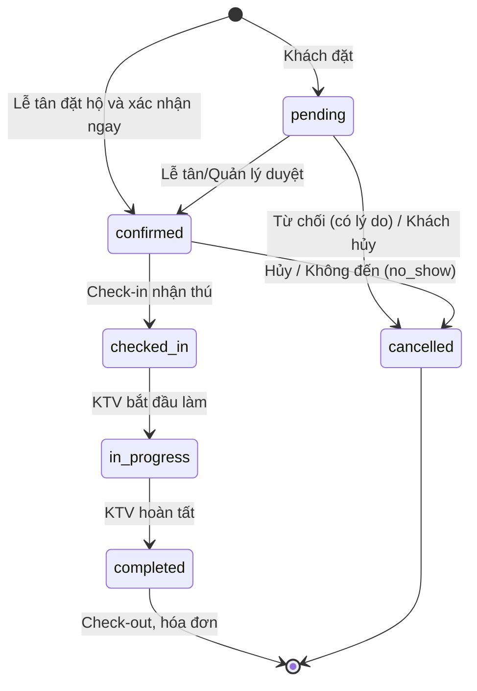
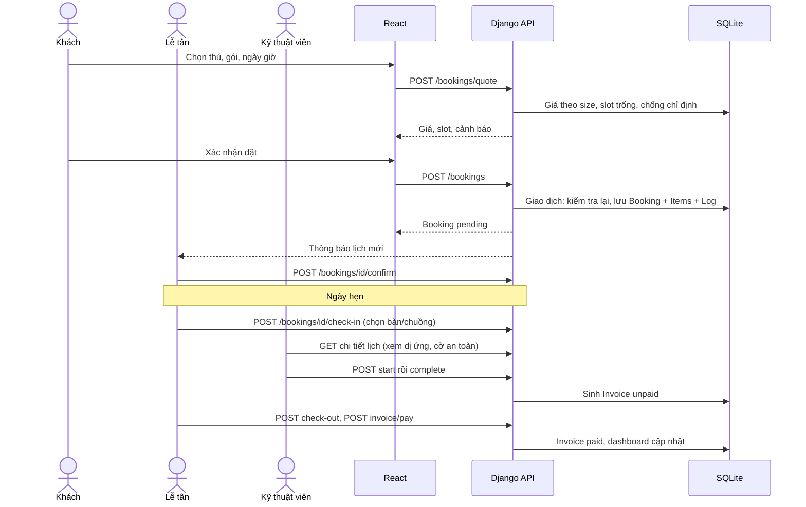
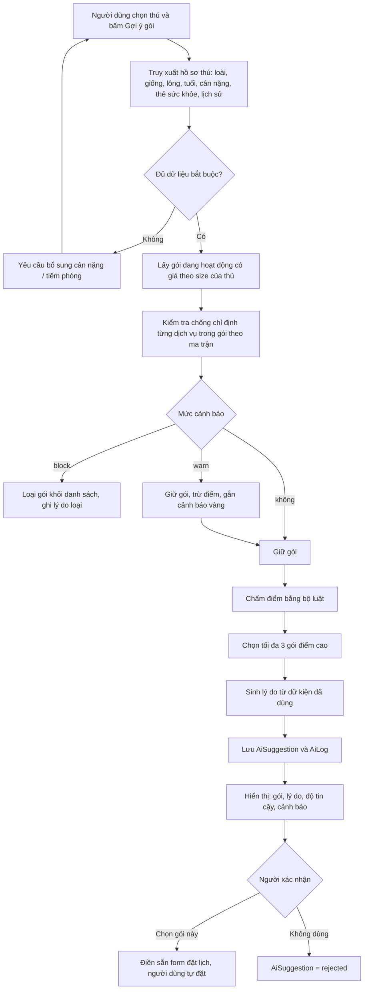
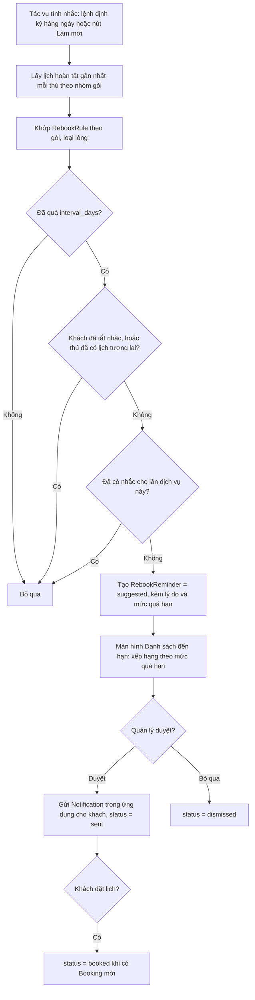

# 05. Quy trình nổi bật

Ba luồng: (1) đặt lịch đến thu tiền, (2) gợi ý gói và cảnh báo hóa chất, (3) nhắc tái spa. Mỗi luồng ghi: dữ liệu vào, người duyệt, chỗ tối ưu so với làm tay.

## 5.1 Luồng 1: Đặt lịch đến thu tiền (SPA-09 đến 20)

### Máy trạng thái lịch hẹn (phải đóng)

Quy tắc chuyển trạng thái:

| Từ | Đến | Ai | Điều kiện |
|----|-----|----|-----------|
| (mới) | `pending` | Khách | Qua kiểm tra trùng/công suất/chống chỉ định |
| (mới) | `confirmed` | Lễ tân, Quản lý | Như trên; đặt hộ tại quầy |
| `pending` | `confirmed` | Lễ tân, Quản lý | Còn slot; cảnh báo `block` đã được quản lý ghi đè |
| `pending` | `cancelled` | Lễ tân, Quản lý (từ chối) / Khách (tự hủy) | Bắt buộc lý do |
| `confirmed` | `cancelled` | Khách (trước giờ hẹn tối thiểu `cancel_cutoff_hours`), Lễ tân, Quản lý | Lý do; `no_show` do lễ tân/quản lý đánh dấu sau giờ hẹn |
| `confirmed` | `checked_in` | Lễ tân | Gán được tài nguyên trống; có `checked_in_at` |
| `checked_in` | `in_progress` | KTV được giao | Đã có kỹ thuật viên |
| `in_progress` | `completed` | KTV được giao | Sinh hóa đơn `unpaid` |
| `completed` | (check-out) | Lễ tân | Ghi `checked_out_at`; mở hóa đơn; cảnh báo nếu chưa thu |

Mọi chuyển trạng thái ngoài bảng bị từ chối với mã lỗi `invalid_transition`. Lịch `pending` quá 24 giờ hoặc quá giờ hẹn hiện ở dashboard mục "cần xử lý" để không bị treo; quản lý xử lý bằng tay.

### Dòng chảy

| Mục | Nội dung |
|-----|----------|
| Dữ liệu vào | `Client`, `Pet` (cân nặng, thẻ sức khỏe, tiêm phòng), `Service`/`Package` + giá, `Resource`, `StaffProfile` + `WorkShift` + `TimeOff`, `Spa` (giờ mở cửa) |
| Quy tắc chặn trùng | Với mỗi `BookingItem` loại tài nguyên T trong khung giờ: số item chồng giờ (lịch `pending/confirmed/checked_in/in_progress`) phải nhỏ hơn số `Resource` hoạt động loại T. Thợ và thú không chồng giờ. Kiểm tra lại **trong giao dịch khi lưu** (khóa bản ghi `Spa` bằng `select_for_update` trên PostgreSQL) |
| Người duyệt | Lễ tân hoặc Quản lý duyệt lịch khách đặt (UC-14) |
| Chỗ tối ưu so với làm tay | Hết trùng lịch và quá tải bàn/chuồng, tối ưu số 1; báo giá đúng theo size, không tranh cãi tại quầy; thợ thấy dị ứng, cờ cắn trước khi nhận; hóa đơn sinh từ lịch thay vì tính tay; dashboard khớp tổng hóa đơn |

## 5.2 Luồng 2: Gợi ý gói và cảnh báo hóa chất (SPA-25, 26, 27)

**Bộ luật chấm điểm (xác định, truy vết được):**

| Mã luật | Nội dung | Tác động |
|---------|----------|----------|
| R1 | Loài của thú không nằm trong `species_scope` của gói | Loại |
| R2 | Tuổi thú nhỏ hơn `min_age_months` của gói | Loại |
| R3 | Dịch vụ trong gói có chống chỉ định `block` với thẻ sức khỏe của thú | Loại, hiển thị lý do |
| R4 | Dịch vụ có chống chỉ định `warn` | Trừ điểm, cảnh báo vàng |
| R5 | Loại lông thú nằm trong `coat_types` của gói | Cộng điểm |
| R6 | Có `RebookRule` khớp và đã đến hạn so với lần hoàn tất gần nhất cùng nhóm dịch vụ | Cộng điểm cho gói cùng nhóm |
| R7 | Thú dùng gói này ở lần hoàn tất gần đây | Cộng điểm nhẹ (quen) |

- **Độ tin cậy** = điểm luật chuẩn hóa về 0–1 và có ý nghĩa xếp hạng, **không phải xác suất thống kê**. Ghi rõ như vậy khi báo cáo.
- **Lý do** ghép từ luật đã bắn và dữ kiện thật, ví dụ: "Poodle lông xoăn; đã 8 tuần kể từ lần cắt gần nhất (luật chu kỳ 6–8 tuần); thú có thẻ da nhạy nên chọn gói dưỡng không hương liệu." Mô hình ngôn ngữ (nếu dùng) chỉ **diễn đạt lại** lý do từ dữ kiện này, không được thêm dữ kiện. Nếu mô hình lỗi thì dùng câu mẫu, luồng vẫn chạy.
- **Cảnh báo chống chỉ định** luôn do luật quyết định, không do mô hình ngôn ngữ. `block` = đỏ, chỉ quản lý ghi đè kèm lý do; `warn` = vàng, người dùng xác nhận đã đọc.

| Mục | Nội dung |
|-----|----------|
| Dữ liệu vào | `Pet` + `HealthTag` + `PetVaccination`, lịch sử `Booking` hoàn tất, `Package` + `Service` + `ServiceContraindication`, `RebookRule`, `SizeBand` + giá |
| Người duyệt | Chính người dùng bấm chấp nhận (khách hoặc lễ tân). Không có chế độ tự đặt |
| Chỗ tối ưu so với làm tay | Tư vấn nhất quán thay vì theo trí nhớ lễ tân; giảm chọn nhầm hóa chất cho thú da nhạy; mỗi gợi ý có lý do và lưu lại để đối chiếu; tăng giá trị đơn có kiểm soát (gợi ý theo gói, không theo món lẻ) |

## 5.3 Luồng 3: Nhắc tái spa (SPA-28, 29)

| Mục | Nội dung |
|-----|----------|
| Dữ liệu vào | `Booking` hoàn tất + `BookingItem`, `Package`, `Pet` (loại lông), `RebookRule`, `Client.allow_reminders` |
| Người duyệt | Quản lý duyệt từng nhắc hoặc duyệt hàng loạt (SPA-29: "người quyết định, hệ thống chỉ xếp hạng") |
| Chỉ gửi qua | Thông báo trong ứng dụng. SMS/Zalo nằm ngoài phạm vi |
| Quy tắc | Một nhắc cho mỗi lần dịch vụ (`unique` theo `last_booking`); khách tắt được; không nhắc nếu đã có lịch tương lai |
| Chỗ tối ưu so với làm tay | Không phải nhớ ai đến hạn cắt; xếp hạng theo mức quá hạn; giảm khách rơi, tăng quay lại. Ví dụ demo: khách Poodle 8 tuần chưa cắt xuất hiện trong danh sách |
