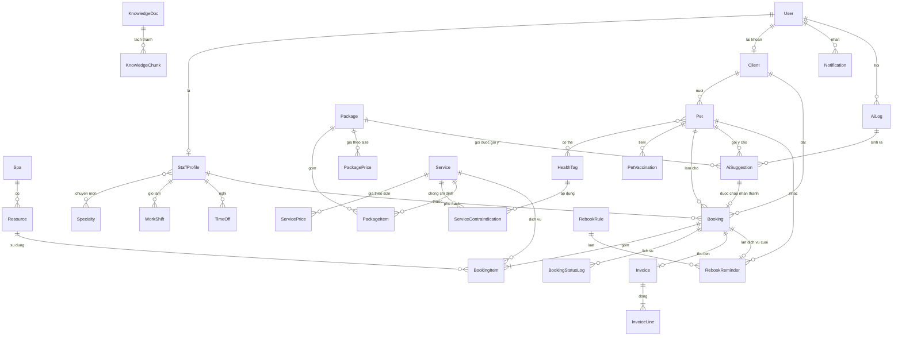

# 06. Dữ liệu

Mức quan niệm/logic (Chương 5). Không phải migration. Tên model và field bằng tiếng Anh; nhãn hiển thị tiếng Việt do frontend và `verbose_name` lo.

Quy ước chung:
- Khóa chính `id` (số nguyên tự tăng) cho mọi bảng, trừ ghi chú khác. Khóa tự nhiên dùng `code` có `unique`.
- Mọi bảng nghiệp vụ có `created_at`, `updated_at` (có múi giờ). Tiền: `DecimalField(max_digits=12, decimal_places=0)`, đơn vị đồng.
- Xóa mềm bằng `is_active` với danh mục và hồ sơ có lịch sử; không xóa cứng bản ghi đã được lịch/hóa đơn tham chiếu.
- Dùng khóa ngoại và ràng buộc của Django (`UniqueConstraint`, `CheckConstraint`) để chuyển PostgreSQL không đổi nghiệp vụ. Không SQL thô.
- Giá trị liệt kê (status, role...) dùng `TextChoices`, lưu chuỗi tiếng Anh.

## 6.1 Sơ đồ quan hệ (ERD)

## 6.2 Thực thể bắt buộc tối thiểu

### Spa (singleton, SPA-01)

| Field | Kiểu | Ghi chú |
|-------|------|---------|
| id | PK | Luôn = 1; `CheckConstraint(id=1)` |
| name | str | "Spa Thú Y Lông Mượt" (giả định) |
| phone, email, address | str | |
| logo | file | Lưu trong `backend/media/` |
| open_time, close_time | time | 08:00–19:00 |
| open_weekdays | list nhỏ (0–6) | Ngày mở cửa |
| slot_minutes | int | Bước slot, mặc định 30 |
| cancel_cutoff_hours | int | Khách chỉ tự hủy trước giờ hẹn X giờ, mặc định 2 |
| timezone | str | `Asia/Ho_Chi_Minh` |

Nguồn phát sinh: quản lý nhập tay một lần, sửa khi đổi thông tin.

### User (SPA-02, 03)

Mở rộng `AbstractUser` của Django.

| Field | Kiểu | Ghi chú |
|-------|------|---------|
| id | PK | |
| username | str unique | |
| password | băm | |
| full_name | str | |
| phone | str | |
| email | str | Tùy chọn |
| role | enum | `customer` / `receptionist` / `technician` / `manager` |
| is_active | bool | Khóa tài khoản |

Nguồn: khách tự đăng ký (`role=customer`); quản lý mời nhân viên.

### Client — Khách hàng (SPA-07)

| Field | Kiểu | Ghi chú |
|-------|------|---------|
| id | PK | |
| user | 1–1 User, null | Null với khách vãng lai nhập ở quầy |
| full_name, phone | str | `phone` unique trong các `Client` đang hoạt động |
| email, address | str | Tùy chọn |
| note | text | Ghi chú nội bộ |
| source | enum | `walk_in` / `online` / `referral` / `other` ("nguồn đến") |
| allow_reminders | bool | Khách có thể tắt nhắc tái spa |
| is_active | bool | |

Nguồn: khách tự đăng ký, hoặc lễ tân nhập khi khách đến quầy.

### Pet — Thú cưng (SPA-08)

| Field | Kiểu | Ghi chú |
|-------|------|---------|
| id | PK | |
| client | FK Client | |
| name | str | |
| species | enum | `dog` / `cat` |
| breed | str | Ví dụ Poodle |
| coat_type | enum | `short` / `long` / `curly` / `double` / `hairless` |
| sex | enum | `male` / `female` / `unknown` |
| birth_date | date | Tuổi tính từ đây |
| weight_kg | decimal(5,2) | Dùng suy ra size |
| size_class | enum | `XS`–`XL`, suy từ `weight_kg` + `SizeBand`, lưu để tra cứu nhanh |
| health_tags | M2M HealthTag | Dị ứng, bệnh da, hành vi (cờ an toàn) |
| allergy_note | text | **Bắt buộc có giá trị**, ghi "Không" nếu không dị ứng |
| safety_note | text | Ghi chú nội bộ cho thợ |
| is_active | bool | |

Nguồn: khách khai khi đăng ký thú; nhân viên bổ sung sau lần đến (cân nặng, dị ứng, cờ an toàn).

**HealthTag** (danh mục thẻ): `code` unique, `name_vi`, `kind` (`allergy` / `skin_condition` / `behavior`). Ví dụ: `fragrance_allergy`, `dermatitis`, `skin_sensitive`, `aggressive`.
**PetVaccination**: `pet` FK, `vaccine_name`, `date_given`, `valid_until`, `note`; unique (`pet`, `vaccine_name`, `date_given`). Bắt buộc có ít nhất một dòng trước khi đặt lịch, hoặc cảnh báo vàng nếu thiếu.
**SizeBand**: `species`, `size_class`, `min_kg`, `max_kg`; không chồng khoảng giữa các band cùng loài.

### Service — Dịch vụ (SPA-04, 06)

| Field | Kiểu | Ghi chú |
|-------|------|---------|
| id | PK | |
| code | str unique | |
| name, description | str, text | |
| category | enum | `bath` / `grooming` / `ear` / `spa` / `other` |
| duration_minutes | int | Thời lượng chuẩn |
| species_scope | enum | `dog` / `cat` / `both` |
| resource_type | enum | Loại tài nguyên cần: `bath_tub` / `grooming_table` / `drying_cage` / `spa_room` |
| required_specialty | FK Specialty, null | Chuyên môn cần |
| supplies_note | text | Vật tư gợi ý, chỉ ghi chú (kho là Pha 3) |
| is_active | bool | |

**ServicePrice**: `service`, `size_class`, `price`; unique (`service`, `size_class`).
**ServiceContraindication** (ma trận SPA-27): `service`, `health_tag`, `severity` (`warn` / `block`), `reason_vi`; unique (`service`, `health_tag`).

Nguồn: quản lý nhập; có seed sẵn 8 dịch vụ.

### Package — Gói combo (SPA-05)

| Field | Kiểu | Ghi chú |
|-------|------|---------|
| id | PK | |
| code | str unique | |
| name, description | str, text | |
| species_scope | enum | `dog` / `cat` / `both` |
| coat_types | list | Loại lông phù hợp, rỗng = mọi loại |
| min_age_months | int | Tuổi tối thiểu |
| is_active | bool | |

**PackageItem**: `package`, `service`, `position`; unique (`package`, `service`).
**PackagePrice**: `package`, `size_class`, `price`; unique (`package`, `size_class`).

Nguồn: quản lý cấu hình; 3 gói mẫu (ví dụ Gói VIP: tắm dưỡng + cắt tỉa + vệ sinh tai).

### Resource — Tài nguyên (SPA-16, 17)

| Field | Kiểu | Ghi chú |
|-------|------|---------|
| id | PK | |
| name | str | "Bàn cắt 1" |
| resource_type | enum | `bath_tub` / `grooming_table` / `drying_cage` / `spa_room` |
| is_active | bool | |

Công suất song song tối đa của từng loại = số `Resource` đang hoạt động loại đó. Không có bảng công suất riêng.
Nguồn: quản lý khai báo danh mục cơ sở.

### Booking — Lịch hẹn (SPA-09 đến 12, 15)

| Field | Kiểu | Ghi chú |
|-------|------|---------|
| id | PK | |
| client | FK Client | |
| pet | FK Pet | |
| package | FK Package, null | Gói đã chọn (nếu đặt theo gói) |
| staff | FK StaffProfile, null | Kỹ thuật viên phụ trách |
| status | enum | `pending` / `confirmed` / `checked_in` / `in_progress` / `completed` / `cancelled` |
| start_at, end_at | datetime | `end_at` = tổng thời lượng các item |
| channel | enum | `online` / `counter` / `walk_in` |
| created_by | FK User | |
| note_internal | text | Chỉ nhân viên xem |
| cancel_reason | text | Bắt buộc khi `cancelled` |
| cancel_reason_code | enum | `rejected` / `customer_cancelled` / `no_show` / `other` |
| checked_in_at, checked_out_at | datetime, null | |
| source_suggestion | FK AiSuggestion, null | Nếu đặt từ gợi ý được chấp nhận |
| safety_override_reason | text | Có khi quản lý ghi đè cảnh báo `block` |
| safety_overridden_by | FK User, null | |
| total_price | decimal | Tổng dòng item, chốt lúc đặt |

**BookingItem**: `booking`, `service`, `position`, `start_at`, `end_at`, `resource_type`, `resource` (FK, null; gán lúc check-in), `unit_price` (chốt giá theo size lúc đặt). Các item của một lịch chạy tuần tự.
**BookingStatusLog**: `booking`, `from_status`, `to_status`, `changed_by`, `changed_at`, `reason`.

Ràng buộc: `end_at > start_at`; unique ngầm theo luật chặn trùng (kiểm tra trong giao dịch, xem [05_quy_trinh.md](05_quy_trinh.md)).
Nguồn: khách/lễ tân khi đặt; kỹ thuật viên và lễ tân khi đổi trạng thái.

### Invoice — Hóa đơn (SPA-19)

| Field | Kiểu | Ghi chú |
|-------|------|---------|
| id | PK | |
| invoice_no | str unique | Dạng `HD-yyyyMMdd-nnn` |
| booking | 1–1 Booking | |
| subtotal, total | decimal | Pha 1–2 `total = subtotal` (chưa có phụ thu/cọc) |
| status | enum | `unpaid` / `paid` / `void` |
| payment_method | enum, null | `cash` / `transfer` |
| paid_at | datetime, null | |
| received_by | FK User, null | |
| void_reason | text | Chỉ quản lý hủy |

**InvoiceLine**: `invoice`, `description`, `quantity`, `unit_price`, `amount`; sao chép từ `BookingItem` (không đổi theo giá về sau).
Nguồn: sinh tự động khi `Booking → completed`; lễ tân ghi thanh toán.

## 6.3 Thực thể AI bắt buộc tối thiểu

### AiSuggestion (bảng `GoiYAI` trong `02_ChucNang`, SPA-25, 26, 30)

| Field | Kiểu | Ghi chú |
|-------|------|---------|
| id | PK | |
| suggestion_type | enum | `package` / `staff` |
| pet | FK Pet, null | Có với `package` |
| package | FK Package, null | Gói được gợi ý |
| staff | FK StaffProfile, null | Thợ được gợi ý |
| target_start_at | datetime, null | Với `staff`: khung giờ đang xét |
| rank | int | 1–3 |
| score | decimal | Điểm luật thô |
| confidence | decimal(3,2) | 0–1, điểm luật chuẩn hóa. **Không phải xác suất** |
| reason_text | text | **Bắt buộc không rỗng** |
| evidence | JSON | Danh sách `{rule, fact}` đã dùng: nền cho `reason_text` |
| warnings | JSON | Danh sách `{severity, health_tag, service, reason}` |
| status | enum | `proposed` / `accepted` / `rejected` / `expired` |
| requested_by | FK User, null | |
| decided_by, decided_at | FK User, datetime | Người bấm chấp nhận/từ chối |
| booking | FK Booking, null | Gắn khi lịch được tạo từ gợi ý |
| ai_log | FK AiLog | |

Nguồn: sinh khi người dùng bấm "Gợi ý gói" hoặc "Gợi ý kỹ thuật viên".

### AiLog (SPA-31)

| Field | Kiểu | Ghi chú |
|-------|------|---------|
| id | PK | |
| kind | enum | `chat` / `suggest_package` / `suggest_staff` / `safety_check` / `rebook` |
| session_id | uuid, null | Nhóm các lượt chatbot |
| user | FK User, null | Null với khách chưa đăng nhập |
| pet | FK Pet, null | |
| input_text | text | Câu hỏi hoặc tham số đã ẩn thông tin cá nhân |
| output_text | text | Câu trả lời hoặc tóm tắt kết quả |
| context_refs | JSON | `KnowledgeChunk.id`, `Pet.id`, mã luật đã dùng |
| engine | str | Tên mô hình hoặc `rules-v1` |
| status | enum | `ok` / `refused` / `error` |
| latency_ms | int | |

Nguồn: mọi lần gọi dịch vụ AI. Không sửa, không xóa.

### KnowledgeDoc (SPA-24)

| Field | Kiểu | Ghi chú |
|-------|------|---------|
| id | PK | |
| title | str | |
| doc_type | enum | `sop` / `price_list` |
| file | file | Lưu ở `backend/media/knowledge/`, **ngoài** cơ sở dữ liệu |
| text_content | text | Văn bản đã trích |
| version | int | |
| uploaded_by | FK User | |
| is_active | bool | Chỉ tài liệu hoạt động được AI dùng |

**KnowledgeChunk**: `doc`, `position`, `heading`, `text`. Truy xuất bằng so khớp từ khóa trên các đoạn (đủ cho một SOP và một bảng giá), chưa cần Vector DB.
Nguồn: quản lý tải lên.

## 6.4 Thực thể hỗ trợ

| Thực thể | Field chính | Phục vụ | Nguồn |
|----------|-------------|---------|-------|
| StaffProfile | `user` 1–1, `specialties` M2M Specialty, `is_active` | SPA-13, 14, 30 | Quản lý mời nhân viên |
| Specialty | `code`, `name_vi` (tắm, cắt Poodle, spa mèo) | SPA-13, 14 | Quản lý |
| WorkShift | `staff`, `weekday`, `start_time`, `end_time` | SPA-13 | Nhân viên/quản lý khai |
| TimeOff | `staff`, `date_from`, `date_to`, `reason` | SPA-13 | Nhân viên xin nghỉ |
| WalkInTicket | `client` null, `contact_name`, `phone`, `pet` null, `service`/`package` quan tâm, `queue_no` (theo ngày), `status` (`waiting` / `called` / `served` / `left`), `estimated_wait_minutes`, `booking` null | SPA-18 [NC] | Lễ tân |
| Notification | `user`, `kind`, `title`, `body`, `ref_type`, `ref_id`, `is_read` | SPA-21, 29 | Hệ thống |
| RebookRule | `package`, `coat_type` null, `species`, `interval_days`, `overdue_days`, `note_vi` | SPA-28 | Quản lý |
| RebookReminder | `client`, `pet`, `last_booking` (unique), `rule`, `due_date`, `overdue_days`, `reason_text`, `status` (`suggested` / `approved` / `sent` / `dismissed` / `booked`), `approved_by`, `approved_at`, `sent_at` | SPA-28, 29 | AI/hệ thống tính |

Không có thực thể riêng cho dashboard, onboarding (SPA-22), công suất: đều tính từ dữ liệu có sẵn.

## 6.5 Truy vết SPA → thực thể

| SPA | Thực thể |
|-----|----------|
| 01 | Spa |
| 02, 03 | User |
| 04, 06 | Service, ServicePrice, SizeBand |
| 05 | Package, PackageItem, PackagePrice |
| 07 | Client |
| 08 | Pet, HealthTag, PetVaccination |
| 09–12 | Booking, BookingItem, BookingStatusLog |
| 13, 14 | StaffProfile, Specialty, WorkShift, TimeOff |
| 15–17 | Booking (check-in/out), Resource |
| 18 | WalkInTicket |
| 19 | Invoice, InvoiceLine |
| 20 | (tính từ Booking, Invoice) |
| 21 | Notification |
| 23, 24 | KnowledgeDoc, KnowledgeChunk, AiLog |
| 25, 26 | AiSuggestion |
| 27 | ServiceContraindication, HealthTag |
| 28, 29 | RebookRule, RebookReminder |
| 30 | AiSuggestion (`staff`) |
| 31 | AiLog, AiSuggestion |

## 6.6 Ràng buộc dữ liệu quan trọng

1. `Pet.allergy_note` không rỗng; `Pet.weight_kg > 0`.
2. `Booking.end_at > Booking.start_at`; mọi `BookingItem` nằm trong `[start_at, end_at]`.
3. `Booking.cancel_reason` bắt buộc khi `status = cancelled`.
4. Một `Booking` có tối đa một `Invoice`; `Invoice` chỉ sinh khi `Booking.status = completed`.
5. `Invoice.status = paid` thì có `payment_method`, `paid_at`, `received_by`.
6. `AiSuggestion.reason_text` không rỗng; `AiSuggestion.booking` chỉ gắn khi người đặt lịch từ gợi ý.
7. `RebookReminder.last_booking` unique: một nhắc cho mỗi lần dịch vụ.
8. Không có đường ghi từ lớp AI vào `Booking` và `Invoice` (kiểm bằng cấu trúc code, xem [07_kien_truc.md](07_kien_truc.md)).
