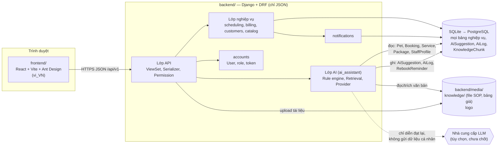
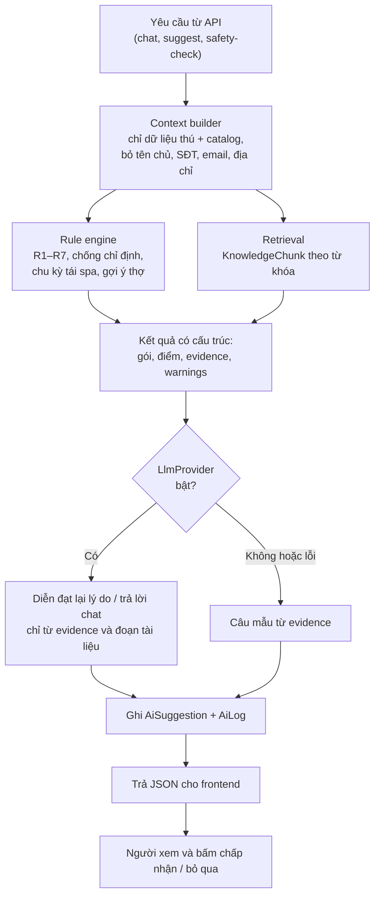

# 07. Kiến trúc

Stack đã chốt: React + Vite + Ant Design gọi API Django REST Framework; Django chỉ trả JSON; SQLite khi làm việc, PostgreSQL lúc bảo vệ. Tài liệu này chỉ mô tả cách ghép, không đổi stack.

## 7.1 Sơ đồ thành phần

## 7.2 Quyết định kiến trúc

| # | Quyết định | Lý do |
|---|-----------|-------|
| 1 | Một backend Django nguyên khối (modular monolith), không microservice, không API gateway | Một cơ sở, nhóm 4 người, 12 tuần. Khác với `DeXuat` có nêu microservice nhưng không phù hợp phạm vi đã chốt |
| 2 | Module trong `backend/` theo nghiệp vụ: `accounts`, `spa`, `catalog`, `customers`, `scheduling`, `billing`, `notifications`, `ai_assistant` | Chia việc theo module. Chỉ là thư mục con của `backend/`, không thêm nhánh mới ngoài `backend/` và `frontend/` |
| 3 | Xác thực bằng token của DRF (`TokenAuthentication`), frontend giữ token | Có sẵn trong DRF; chưa cần JWT. Nếu cần token có hạn thì quyết sau |
| 4 | Dev: Vite proxy `/api` sang Django | Tránh thêm package CORS khi làm việc. Lúc bảo vệ có thể chạy build tĩnh phía sau cùng domain |
| 5 | File SOP và bảng giá lưu ở `backend/media/knowledge/`; văn bản trích và đoạn nằm trong CSDL (`KnowledgeDoc`, `KnowledgeChunk`) | Đúng ràng buộc "file SOP nằm ở backend". Giải thích được AI lấy dữ liệu ở đâu |
| 6 | Nhật ký gợi ý nằm trong CSDL (`AiLog`, `AiSuggestion`), không ghi vào tệp log | Truy vấn được, hiển thị ở SPA-31, đối chiếu khi bảo vệ |
| 7 | Hóa đơn PDF: frontend dựng hóa đơn từ JSON và dùng "In → Lưu thành PDF" của trình duyệt | Giữ nguyên "backend chỉ trả JSON"; không thêm thư viện PDF phía server |
| 8 | Chống đặt trùng: kiểm tra trong `transaction.atomic`, khóa dòng `Spa` bằng `select_for_update` | Có tác dụng trên PostgreSQL; trên SQLite ghi tuần tự nên cũng an toàn. Đủ cho một cơ sở |
| 9 | Truy xuất tri thức bằng từ khóa trên `KnowledgeChunk`, chưa dùng Vector DB | Chỉ một SOP và một bảng giá; tránh thêm hạ tầng. Có thể thay bằng embedding sau mà không đổi API |
| 10 | Thông báo chỉ trong ứng dụng (`Notification`, frontend lấy theo chu kỳ) | SMS/Zalo/email nằm ngoài Pha 1–2 |

## 7.3 Lớp AI: ba thành phần, người luôn quyết

Nguyên tắc:

- **Cảnh báo chống chỉ định và gợi ý gói là kết quả của luật** (xác định, giải thích được). Mô hình ngôn ngữ chỉ diễn đạt lại và trả lời chatbot. Mô hình lỗi thì hệ thống vẫn chạy.
- `ai_assistant` chỉ ghi vào `AiSuggestion`, `AiLog`, `RebookReminder`, `KnowledgeChunk`. Mã của module này **không import** các hàm tạo/sửa `Booking`, `Invoice`. Đây là điều kiện kiểm khi review.
- `LlmProvider` là một giao diện nhỏ (tên mô hình, khóa API qua biến môi trường). **Nhà cung cấp LLM chưa chốt**; xem câu hỏi mở ở dưới. Hệ thống phải chạy được khi `LlmProvider` tắt.
- Chatbot: truy xuất đoạn tài liệu liên quan, trả lời kèm tên tài liệu/mục nguồn; không có đoạn phù hợp thì trả "Spa chưa có thông tin về việc này, vui lòng liên hệ lễ tân". Câu hỏi chẩn đoán/thuốc trả lời theo tài liệu và nhắc đưa thú đến bác sĩ thú y.

## 7.4 Quy ước API chung

- Tiền tố `/api/v1/`. Dữ liệu JSON, khóa `snake_case` tiếng Anh. Thời gian ISO 8601 có múi giờ.
- Lỗi thống nhất: `{"code": "slot_full", "detail": "Khung giờ này đã hết chỗ.", "fields": {}}`. `code` tiếng Anh để frontend xử lý; `detail` tiếng Việt để hiển thị.
- Phân trang `?page=&page_size=`; lọc bằng tham số truy vấn.
- Mã HTTP: 401 chưa đăng nhập, 403 sai quyền, 404 không thấy hoặc ngoài phạm vi dữ liệu của mình, 409 xung đột (trùng lịch, chuyển trạng thái sai), 422 dữ liệu không hợp lệ.

## 7.5 Triển khai khi bảo vệ

- Máy nhóm chạy `backend` (Django) và `frontend` (Vite), hoặc một process Django phục vụ bản build tĩnh.
- Chuyển PostgreSQL: đổi `DATABASES`, `migrate`, chạy lại lệnh nạp dữ liệu mẫu. Không đổi mã nghiệp vụ (xem NFR-10).
- Chuyển giao (Chương 6, slide): hướng dẫn người dùng theo vai trò; chuyển đổi dữ liệu là nạp bộ mẫu; chuyển đổi hệ thống theo kiểu thử nghiệm (demo).

## 7.6 Câu hỏi mở

| # | Câu hỏi | Mặc định đề xuất |
|---|---------|------------------|
| 1 | Dùng nhà cung cấp LLM nào cho chatbot và diễn đạt lý do? | Chưa chốt. Đề xuất một nhà cung cấp có hỗ trợ tiếng Việt và khóa API miễn phí/ít tiền; đặt sau `LlmProvider` |
| 2 | Chatbot cho phép khách chưa đăng nhập hỏi không? | Có, chế độ chung (không đọc hồ sơ thú), giới hạn tần suất theo IP |
| 3 | Tải lên tài liệu tri thức nhận định dạng nào? | `.docx`, `.pdf`, `.txt`, `.md`, `.xlsx` cho bảng giá |
