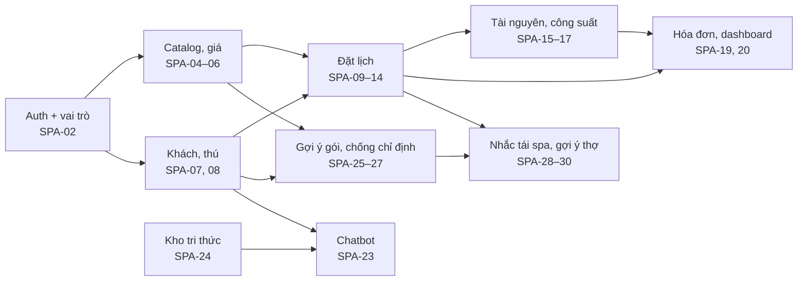

# 10. Thứ tự làm và chia 4 người

Bám `03_ThuTuXay` (12 tuần): Pha 1 rồi mới Pha 2. Quy tắc từ tài liệu: (1) không viết chatbot ở tuần 1; (2) không làm định tuyến/định vị; (3) mỗi tuần demo được một vòng nhỏ; (4) trễ thì cắt Pha 3, giữ Pha 2; (5) sớm mới lấy Pha 4. **Không làm chatbot trước khi có thú và lịch.**

## 10.1 Lộ trình theo tuần

| Tuần | Mốc | Việc phải xong | SPA | Demo được |
|------|-----|----------------|-----|-----------|
| T1 | Chốt phạm vi + mô hình | Bộ tài liệu thiết kế này; use case tổng, actor, ERD; khởi tạo repo, khung `backend/` và `frontend/`, cấu hình Ant Design `vi_VN`; đăng nhập 4 vai trò | 01, 02 | Đăng nhập, menu khác nhau theo vai |
| T1–T2 | Master data sống | Hồ sơ spa; catalog, gói, giá theo size; khách + thú (dị ứng, tiêm); nạp dữ liệu mẫu | 03–08 | Seed 10 khách, 12 thú, 8 dịch vụ, 3 gói |
| T2–T3 | Đặt lịch một vòng | Lịch tháng/ngày; tạo–sửa–hủy; duyệt; danh sách; chi tiết; nhân sự và giờ làm; gán thợ | 09–14 | Đặt trùng khung giờ bị chặn |
| T3–T4 | Vận hành tại quầy | Bảng lễ tân; check-in/out; tài nguyên và công suất; walk-in nếu kịp | 15–18 | 8 lịch + 2 walk-in giả lập |
| T4–T5 | Khép tiền + dashboard | Hóa đơn từ lịch, in, ghi đã thu; dashboard ngày; thông báo | 19–22 | Doanh thu một ngày khớp tổng hóa đơn |
| **Mốc Pha 1** | Cuối T5 | Vòng đời thú: đặt lịch → nhận → làm → thu tiền chạy đủ | | |
| T6 | Tri thức + chatbot | Nạp SOP và bảng giá; chatbot bám tài liệu; nhật ký | 23, 24, 31 | 3 câu mẫu: lịch tắm Poodle, thú viêm da, giá gói VIP |
| T6–T7 | Gợi ý gói + lý do + chống chỉ định | `AiSuggestion` có độ tin cậy và lý do; cảnh báo hóa chất; chấp nhận mới điền form | 25–27 | Poodle da nhạy → 1–3 gói + cảnh báo đỏ/vàng |
| T7 | Nhắc tái spa + gợi ý thợ | Luật chu kỳ; danh sách đến hạn; gợi ý thợ | 28–30 | Poodle 8 tuần chưa cắt có trong danh sách |
| **Mốc Pha 2** | Cuối T7 | Đóng băng chức năng Pha 1–2 | | |
| T8–T9 | Dự phòng / Pha 3 nếu còn sức | Kho, phiếu, ảnh, checklist... **giai đoạn sau, cắt nếu trễ** | 32–46 | |
| T10–T12 | Bảo vệ | Kiểm thử; chạy kịch bản `06_KichBanDemo`; UML/ERD/kiến trúc khớp hiện trạng; WBS/Gantt; ghi hạn chế AI; chuyển PostgreSQL | | Báo cáo + demo 10–12 phút |

Ghi chú: tài liệu gốc đặt Pha 3 ở T8–T9. Bản này xem đó là **dự phòng** và ưu tiên dùng thời gian T8–T9 để củng cố Pha 1–2 (kiểm thử, sửa lỗi, chuẩn bị tài liệu). Chỉ mở Pha 3 khi Pha 1–2 đã đóng và đã kiểm thử.

## 10.2 Phụ thuộc bắt buộc

Rủi ro nếu đảo thứ tự (từ tài liệu): thiếu hồ sơ thú thì AI không có đầu vào; lịch không ràng công suất thì chưa có điểm tối ưu; không thu được tiền thì quy trình đứt; chatbot không đọc tài liệu spa là AI gắn thêm.

## 10.3 Chia việc 4 người

Theo `03_ThuTuXay`. Thành viên A–D là vai trong nhóm; nhóm tự gán tên.

| Thành viên | Trọng tâm | Pha 1 | Pha 2 | Bảo vệ |
|------------|-----------|-------|-------|--------|
| **A – Nghiệp vụ** | Phạm vi, use case, dữ liệu, WBS, kiểm thử | Hồ sơ spa (01), actor, ERD, tài liệu thiết kế, dữ liệu mẫu, kịch bản kiểm thử | Kịch bản kiểm AI (câu hỏi mẫu, ca chống chỉ định, ca tái spa); ma trận chống chỉ định và luật chu kỳ (nội dung) | Báo cáo Word, slide, dẫn 6 câu hỏi phạm vi, WBS/Gantt |
| **B – Lịch và quầy** | Lịch, lễ tân, công suất | Máy trạng thái lịch, chặn trùng, calendar, duyệt, check-in/out, tài nguyên (SPA-09–18) | Gợi ý thợ (30) | Demo vòng đời thú |
| **C – Hồ sơ và tiền** | Khách, thú, hóa đơn | Đăng nhập/phân quyền (02, 03), khách, thú, catalog/giá (04–08), hóa đơn, dashboard, thông báo (19–21) | Thẻ sức khỏe/tiêm phục vụ AI (dữ liệu đầu vào chất lượng) | Đối chiếu số dashboard với hóa đơn |
| **D – AI và kiến trúc** | Khung API, AI | Khung `backend/` + `frontend/`, quy ước API, bộ khung lỗi và quyền | Toàn bộ Pha 2: kho tri thức, chatbot, gợi ý gói, giải thích, chống chỉ định (động cơ), nhắc tái spa, nhật ký (23–31) | Giải thích nguồn dữ liệu AI |

Điểm giao nhau cần họp trước khi code:
- B và C thống nhất `Booking`, `Pet`, `Client` (cột, trạng thái) từ T1; D chỉ **đọc** chúng.
- C chốt danh mục `HealthTag` với A trước T2 (đầu vào cho AI).
- D cung cấp lớp quyền DRF dùng chung cho B và C từ T1.

## 10.4 Quy ước làm việc nhóm

- Nhánh Git bằng tiếng Anh: `feature/spa-09-booking-state-machine`, `feature/spa-25-package-suggestion`, `fix/...`, `docs/...`. Nhánh gốc `main`; tích hợp qua `develop` hoặc pull request vào `main` (nhóm chọn một).
- Commit nhỏ, có mã SPA trong thông điệp.
- Một chức năng chỉ được tính **xong** khi đạt định nghĩa xong ở [01_to_chuc_bai_toan.md](01_to_chuc_bai_toan.md) mục 1.4.
- Họp ngắn cuối mỗi tuần: demo một vòng nhỏ, cập nhật Gantt.

## 10.5 Rủi ro chính

| Rủi ro | Giảm thiểu |
|--------|-----------|
| Lịch và quầy (B) nghẽn tuần 3–4, kéo theo hóa đơn | Walk-in (18) lùi nếu nghẽn, giữ công suất (16) và tài nguyên (17) |
| AI phụ thuộc dữ liệu thú đầy đủ | Seed 12 thú sớm (T2) có dị ứng và tiêm; chặn đặt lịch thiếu dữ liệu |
| Nhà cung cấp LLM chưa chốt, hết hạn mức | Bộ luật + câu mẫu chạy không cần LLM; LLM chỉ diễn đạt lại |
| Thêm tính năng sát hạn nộp | Đóng băng Pha 1–2 cuối T7; Pha 4 chỉ làm khi sớm |
| Chuyển PostgreSQL phát sinh lỗi | Chạy test trên PostgreSQL từ T9, không để đến sát bảo vệ |
